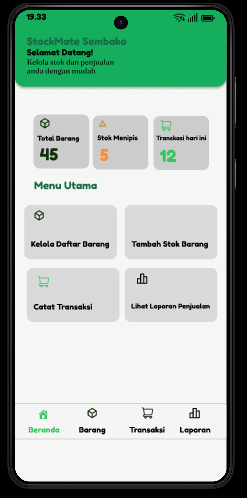

# LAPORAN UJIAN TENGAH SEMESTER (UTS)
# PERANCANGAN APLIKASI STOCKMATE SEMBAKO

## Identitas Mahasiswa

- Nama: Kustiawan Harit Kusuma
- NIM : 2305101129
- Program Studi: Teknik Informatika
- Kelas: 7E
- Mata Kuliah: Pemrograman Bergerak
- Dosen Pengampu: Moch Yusuf Asyhari, S.Tr.Kom., M.Kom

---

## BAB I. PENDAHULUAN

### 1.1 Latar Belakang

Toko sembako merupakan salah satu jenis usaha yang menyediakan berbagai kebutuhan pokok masyarakat. Dalam menjalankan kegiatan operasionalnya, pemilik toko perlu mengetahui jumlah persediaan barang, mencatat barang yang masuk, serta memantau transaksi penjualan.

Pada toko sembako yang menjadi objek perancangan ini, pengecekan persediaan barang masih dilakukan secara langsung dengan melihat kondisi barang pada rak. Cara tersebut dapat digunakan untuk mengetahui kondisi stok, tetapi pengelolaan persediaan dan pencatatan transaksi akan lebih terbantu apabila tersedia sistem yang terorganisasi.

Berdasarkan kebutuhan tersebut, dirancang aplikasi mobile bernama **StockMate Sembako**. Aplikasi ini ditujukan untuk membantu pemilik toko dalam mengelola data barang, mencatat barang masuk, mencatat transaksi penjualan, serta melihat laporan penjualan.

Pada tahap UTS ini, pekerjaan difokuskan pada analisis kebutuhan, perancangan antarmuka, struktur navigasi, manajemen data, dan rancangan interaksi perangkat bergerak. Implementasi aplikasi akan menjadi tahap pengembangan selanjutnya.

### 1.2 Rumusan Masalah

1. Bagaimana merancang aplikasi mobile untuk membantu pengelolaan stok barang toko sembako?
2. Bagaimana merancang antarmuka yang mudah digunakan oleh pemilik toko?
3. Bagaimana merancang navigasi dan pengelolaan data barang serta transaksi?
4. Bagaimana memanfaatkan karakteristik perangkat bergerak dalam rancangan aplikasi?

### 1.3 Tujuan

1. Menghasilkan rancangan aplikasi StockMate Sembako.
2. Merancang antarmuka pengguna yang sederhana dan mudah dipahami.
3. Menentukan struktur navigasi aplikasi.
4. Merancang pengelolaan data barang, barang masuk, dan transaksi penjualan.
5. Menentukan kebutuhan interaksi dengan perangkat keras smartphone.

### 1.4 Batasan Masalah

1. Aplikasi dirancang untuk satu pengguna, yaitu pemilik toko.
2. Aplikasi ditujukan untuk perangkat bergerak berbasis Android.
3. Fitur utama meliputi pengelolaan barang, barang masuk, penjualan, dan laporan.
4. Penyimpanan data direncanakan menggunakan database lokal pada perangkat.
5. Rancangan belum mencakup sinkronisasi cloud, pengelolaan banyak cabang, maupun sistem akuntansi lengkap.
6. Tahap UTS berfokus pada perancangan UI/UX dan prototype, sedangkan implementasi sistem direncanakan pada tahap UAS.

---

## BAB II. ANALISIS KEBUTUHAN PENGGUNA

### 2.1 Identifikasi Pengguna

Pengguna utama aplikasi StockMate Sembako adalah pemilik toko sembako yang melakukan kegiatan pengelolaan barang dan transaksi penjualan secara mandiri melalui smartphone Android.

### 2.2 Permasalahan yang Ditemukan

Berdasarkan gambaran proses pengelolaan toko, pengecekan persediaan barang dilakukan dengan melihat kondisi barang secara langsung pada rak. Pemilik toko menentukan kebutuhan penambahan stok ketika persediaan barang mulai sedikit atau habis.

Kondisi tersebut menjadi dasar perlunya rancangan sistem yang dapat membantu menyimpan informasi stok dan mencatat perubahan persediaan melalui aktivitas barang masuk dan penjualan.

### 2.3 Kebutuhan Fungsional

| No. | Kebutuhan | Keterangan |
|---|---|---|
| 1 | Data barang | Menambah, melihat, mengubah, dan menghapus data barang |
| 2 | Barang masuk | Mencatat penambahan persediaan barang |
| 3 | Penjualan | Mencatat barang yang dijual |
| 4 | Perhitungan transaksi | Menghitung subtotal dan total pembayaran secara otomatis |
| 5 | Pembaruan stok | Memperbarui stok setelah barang masuk atau terjual |
| 6 | Informasi stok menipis | Menampilkan informasi barang yang mencapai batas stok minimum |
| 7 | Riwayat transaksi | Menampilkan catatan transaksi penjualan |
| 8 | Laporan | Menampilkan ringkasan penjualan harian dan bulanan |

### 2.4 Kebutuhan Nonfungsional

1. **Kemudahan penggunaan:** Tampilan harus sederhana dan mudah dipahami.
2. **Kinerja:** Proses menampilkan data dan mencatat transaksi diharapkan berjalan dengan cepat.
3. **Keandalan:** Data stok dan transaksi harus tercatat secara konsisten.
4. **Keamanan:** Akses terhadap data toko perlu dijaga.
5. **Ketersediaan offline:** Fitur utama direncanakan dapat digunakan tanpa koneksi internet dengan penyimpanan lokal.
6. **Kompatibilitas:** Aplikasi dirancang untuk perangkat Android.

---

## BAB III. KARAKTERISTIK PERANGKAT BERGERAK

### 3.1 Platform Perangkat

Aplikasi StockMate Sembako dirancang untuk smartphone berbasis Android. Perangkat bergerak dipilih karena praktis digunakan oleh pemilik toko dalam kegiatan operasional sehari-hari.

### 3.2 Karakteristik Perangkat yang Dimanfaatkan

| Komponen | Pemanfaatan |
|---|---|
| Layar sentuh | Memilih menu, mengisi formulir, dan menjalankan fitur aplikasi |
| Keyboard virtual | Memasukkan nama barang, jumlah, harga, dan informasi lainnya |
| Prosesor | Memproses data barang dan perhitungan transaksi |
| RAM | Mendukung aplikasi berjalan dengan lancar |
| Penyimpanan internal | Menyimpan database lokal aplikasi |
| Kamera | Berpotensi dimanfaatkan untuk pemindaian barcode pada pengembangan berikutnya |
| Speaker atau getaran | Dapat digunakan untuk memberikan pemberitahuan |

### 3.3 Kebutuhan Koneksi

Fitur utama aplikasi direncanakan menggunakan database lokal sehingga pengelolaan barang dan pencatatan transaksi tidak bergantung pada koneksi internet secara terus-menerus.

---

## BAB IV. PERANCANGAN ANTARMUKA PENGGUNA (UI/UX)

### 4.1 Konsep Desain

Aplikasi StockMate Sembako menggunakan konsep desain sederhana, modern, dan mudah digunakan. Warna utama yang digunakan adalah hijau, putih, dan abu-abu muda.

Warna hijau digunakan sebagai identitas aplikasi, sedangkan warna putih dan abu-abu muda digunakan untuk memberikan tampilan yang bersih dan memudahkan pengguna membaca informasi.

Desain dibuat menggunakan Figma dengan ukuran frame Android Compact 412 × 917 piksel.

### 4.2 Halaman Dashboard

Dashboard merupakan halaman utama yang menampilkan ringkasan informasi toko dan akses menuju fitur utama.

Komponen yang dirancang meliputi:
- Nama aplikasi StockMate Sembako.
- Total barang.
- Informasi stok menipis.
- Jumlah transaksi hari ini.
- Menu Data Barang.
- Menu Barang Masuk.
- Menu Penjualan.
- Menu Laporan Penjualan.

### 4.3 Halaman Data Barang

Halaman Data Barang digunakan untuk menampilkan daftar persediaan barang. Halaman ini memiliki kolom pencarian, tombol tambah barang, serta informasi nama, harga, dan stok barang.

### 4.4 Halaman Barang Masuk

Halaman Barang Masuk dirancang untuk mencatat penambahan persediaan barang. Formulir terdiri dari pilihan nama barang, jumlah barang masuk, tanggal masuk, dan catatan opsional.

### 4.5 Halaman Penjualan

Halaman Penjualan digunakan untuk mencatat transaksi penjualan. Pengguna dapat memilih barang, menentukan jumlah, dan melihat rincian transaksi.

Sistem direncanakan menghitung subtotal berdasarkan jumlah barang dikalikan harga satuan, kemudian menjumlahkan seluruh subtotal untuk memperoleh total pembayaran.

### 4.6 Halaman Laporan Penjualan

Halaman Laporan Penjualan dirancang untuk menampilkan ringkasan transaksi berdasarkan periode harian dan bulanan. Informasi yang ditampilkan meliputi total penjualan, jumlah transaksi, dan riwayat transaksi.

---

## BAB V. STRUKTUR NAVIGASI APLIKASI

### 5.1 Struktur Navigasi

Struktur navigasi dirancang agar pengguna dapat berpindah dari Dashboard menuju empat fitur utama aplikasi.

Halaman utama menyediakan akses menuju:
1. Data Barang.
2. Barang Masuk.
3. Penjualan.
4. Laporan Penjualan.

Navigasi bawah juga disediakan agar pengguna dapat berpindah antarhalaman dengan lebih mudah.

### 5.2 Diagram Struktur Navigasi
Berikut merupakan diagram struktur navigasi aplikasi stockmate sembako :

### 5.3 Rancangan Alur Navigasi

- Dashboard → Data Barang
- Dashboard → Barang Masuk
- Dashboard → Penjualan
- Dashboard → Laporan Penjualan
- Data Barang → Dashboard, Barang, Penjualan, dan Laporan
- Barang Masuk → Dashboard, Barang, Penjualan, dan Laporan
- Penjualan → Dashboard, Barang, Penjualan, dan Laporan
- Laporan Penjualan → Dashboard, Barang, Penjualan, dan Laporan

### 5.3 Prototype

Prototype dibuat menggunakan fitur Prototype pada Figma. Setiap menu utama dan navigasi bawah dihubungkan menggunakan interaksi On Tap dengan aksi Navigate to.

Link prototype: [Masukkan link prototype Figma di sini]

---

## BAB VI. PERANCANGAN MANAJEMEN DATA

### 6.1 Rencana Penyimpanan Data

Pengelolaan data direncanakan menggunakan database lokal SQLite dengan Room sebagai lapisan akses database pada pengembangan Android.

Pendekatan tersebut dipilih agar data dapat disimpan langsung di perangkat dan fitur utama tetap dapat digunakan tanpa koneksi internet.

### 6.2 Rancangan Entitas Data

**1. Barang**

Menyimpan informasi barang, seperti:
- ID barang.
- Nama barang.
- Kategori.
- Satuan.
- Stok saat ini.
- Stok minimum.
- Harga jual.

**2. Transaksi**

Menyimpan informasi transaksi, seperti:
- ID transaksi.
- Tanggal dan waktu.
- Jenis transaksi.
- Total transaksi.

**3. Detail Transaksi**

Menyimpan rincian barang pada setiap transaksi, seperti:
- ID detail.
- ID transaksi.
- ID barang.
- Jumlah barang.
- Harga satuan saat transaksi.
- Subtotal.

Data barang masuk juga direncanakan dicatat dengan informasi barang, jumlah, tanggal, dan catatan jika diperlukan.

### 6.3 Perhitungan Stok

Perubahan persediaan direncanakan menggunakan rumus:

**Stok akhir = Stok awal + Barang masuk − Barang terjual**

### 6.4 Perhitungan Penjualan

Subtotal dihitung menggunakan rumus:

**Subtotal = Jumlah barang × Harga satuan**

Total transaksi diperoleh dari penjumlahan seluruh subtotal barang dalam satu transaksi.

---

## BAB VII. RANCANGAN INTERAKSI HARDWARE

Interaksi dengan perangkat keras dirancang untuk mendukung kemudahan penggunaan aplikasi pada smartphone Android.

1. **Layar sentuh:** Digunakan untuk memilih menu, tombol, dan komponen antarmuka.
2. **Keyboard virtual:** Digunakan untuk memasukkan data barang dan transaksi.
3. **Penyimpanan internal:** Digunakan untuk menyimpan database lokal.
4. **Prosesor dan RAM:** Mendukung pemrosesan data dan jalannya aplikasi.
5. **Kamera:** Dapat dikembangkan untuk mendukung pemindaian barcode barang pada tahap berikutnya.
6. **Speaker atau getaran:** Dapat digunakan sebagai pemberitahuan ketika proses pencatatan berhasil.

Pada rancangan awal, kamera, speaker, dan getaran merupakan fitur pendukung yang masih bersifat opsional.

---

## BAB VIII. KESIMPULAN

Berdasarkan hasil analisis dan perancangan, aplikasi StockMate Sembako dirancang sebagai solusi mobile untuk membantu pengelolaan persediaan barang dan pencatatan transaksi pada toko sembako.

Rancangan mencakup lima halaman utama, yaitu Dashboard, Data Barang, Barang Masuk, Penjualan, dan Laporan Penjualan. Selain itu, telah dirancang struktur navigasi, kebutuhan fungsional dan nonfungsional, konsep manajemen data lokal, serta interaksi dengan perangkat keras smartphone.

Pada tahap UTS, hasil pekerjaan berupa rancangan antarmuka dan prototype menggunakan Figma. Rancangan tersebut akan menjadi dasar dalam proses implementasi aplikasi Android pada tahap UAS.

---

## DAFTAR PUSTAKA

1. Android Developers. *Guide to App Architecture*. https://developer.android.com/topic/architecture
2. Android Developers. *Build an Offline-First App*. https://developer.android.com/topic/architecture/data-layer/offline-first
3. SQLite. *About SQLite*. https://www.sqlite.org/about.html
4. Android Developers. *Save Data in a Local Database Using Room*. https://developer.android.com/training/data-storage/room
5. Figma. *Figma Design*. https://www.figma.com/
