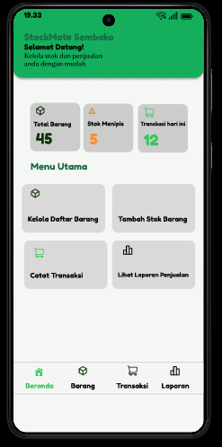

# StockMate Sembako

**Perancangan Aplikasi Mobile untuk Pengelolaan Stok dan Transaksi Penjualan Toko Sembako**

## Deskripsi Proyek

StockMate Sembako merupakan rancangan aplikasi mobile berbasis Android yang ditujukan untuk membantu pemilik toko sembako dalam mengelola persediaan barang, mencatat barang masuk, melakukan pencatatan transaksi penjualan, dan melihat laporan penjualan.

Proyek ini dikembangkan sebagai tugas mata kuliah Pemrograman Bergerak. Pada tahap UTS, fokus pengembangan berada pada analisis kebutuhan, perancangan UI/UX, struktur navigasi, manajemen data, dan prototype menggunakan Figma. Implementasi aplikasi direncanakan pada tahap UAS.

## Tujuan

- Mempermudah pengelolaan data barang.
- Membantu pencatatan barang masuk.
- Membantu pencatatan transaksi penjualan.
- Menampilkan informasi stok barang.
- Menyediakan rancangan laporan penjualan harian dan bulanan.

## Fitur Utama

1. **Dashboard** — Menampilkan ringkasan informasi toko.
2. **Data Barang** — Mengelola informasi barang dan persediaan.
3. **Barang Masuk** — Mencatat penambahan stok barang.
4. **Penjualan** — Merancang pencatatan transaksi dan perhitungan total pembayaran.
5. **Laporan Penjualan** — Menampilkan rancangan ringkasan penjualan harian dan bulanan.

## Preview UI/UX

### 1. Dashboard

### 2. Data Barang

### 3. Form Barang Masuk

### 4. Transaksi Penjualan

### 5. Laporan Penjualan

## Prototype Figma

Prototype dapat dicoba melalui tautan berikut:

[**Buka Prototype StockMate Sembako**](https://www.figma.com/proto/NZNqmCpf8fAB5ks0IsIICN/UI--UX-StockMate-Sembako?node-id=10-68&t=VTYWiH25QPLUYJjB-0&scaling=scale-down&content-scaling=fixed&page-id=0%3A1&starting-point-node-id=10%3A68)

## Dokumentasi

Laporan lengkap UTS dapat dilihat melalui:

[**Lihat Laporan UTS StockMate Sembako**](Laporan-Uts.md)

## Teknologi dan Tools Perancangan

- Figma — Perancangan antarmuka dan prototype.
- GitHub — Penyimpanan repository dan dokumentasi proyek.
- Android — Platform target aplikasi.
- SQLite dan Room — Teknologi database lokal yang direncanakan untuk tahap implementasi.

## Pengembangan Selanjutnya

Pada tahap UAS, proyek akan dilanjutkan ke implementasi aplikasi Android berdasarkan hasil analisis dan rancangan yang telah dibuat pada tahap UTS.
